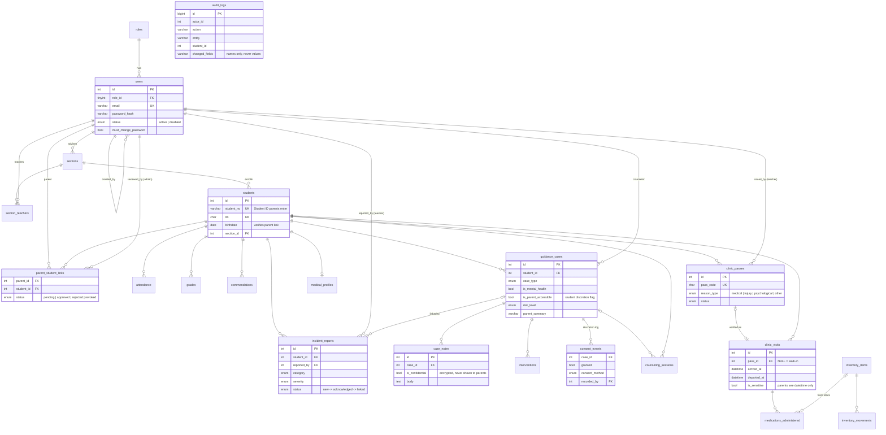

# BEACON — Entity Relationship Diagram

Renders on GitHub, in VS Code (Markdown Preview Mermaid Support), or at https://mermaid.live.

`audit_logs` and `login_attempts` have no foreign keys on purpose: logs must outlive the records they describe.

## How the spec's entities map to tables

| Spec entity        | Tables |
|--------------------|--------|
| Users, Roles       | `users`, `roles`, `login_attempts` |
| Students           | `students`, `sections`, `section_teachers` |
| Parent_Links       | `parent_student_links` |
| Attendance         | `attendance` (+ `grades` for academic performance) |
| Guidance_Records   | `incident_reports` (teacher → guidance inbox), `guidance_cases`, `case_notes`, `interventions`, `counseling_sessions`, `consent_events` |
| Clinic_Records     | `clinic_passes`, `clinic_visits`, `medical_profiles`, `medications_administered`, `inventory_items`, `inventory_movements` |
| Commendations      | `commendations` |
| Audit trail        | `audit_logs` (append-only, enforced by triggers) |
| Early warning      | `v_wellbeing_signals` view (30-day counts per student) |

## Who can see what

| Data | Super Admin | Teacher | Guidance | Clinic | Parent |
|---|---|---|---|---|---|
| Accounts, parent-link approvals, system activity | ✅ | – | – | – | – |
| Attendance, grades | – | own sections | ✅ | – | (later module) |
| Incident reports | – | own submissions | ✅ | – | – |
| Guidance cases (non-mental-health) | – | – | ✅ | – | ✅ approved link |
| Guidance cases (mental health) | – | – | ✅ | – | only if `is_parent_accessible = 1`; otherwise a locked "private" card |
| Confidential case notes | – | – | ✅ (decrypted, each read logged) | – | never |
| Clinic visits | – | – | – | ✅ | ✅ (sensitive visits: date/time only) |
| Commendations | – | ✅ | ✅ | – | ✅ |
